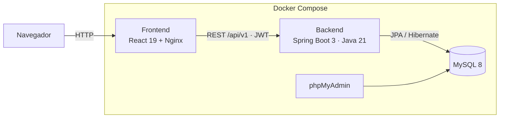

# Gestor Académico Virtual

[](https://github.com/ivanechajay07/GestorAcad/actions/workflows/ci.yml)


Plataforma web para la **gestión académica universitaria**. Centraliza la estructura académica, el padrón de estudiantes, el claustro docente, las evaluaciones, los portales de consulta y la administración de usuarios, con control de acceso por roles, auditoría de operaciones y reportes institucionales.

### Resumen del proyecto

| Aspecto | Detalle |
| :--- | :--- |
| **Problema** | La información académica suele estar dispersa entre hojas de cálculo y procesos manuales, sin trazabilidad ni control de acceso. |
| **Solución** | Una plataforma integrada con una API REST, base de datos normalizada y una interfaz web común para estudiantes, docentes y administradores. |
| **Alcance** | Universidad, facultades y carreras; periodos, cursos, planes, secciones y matrículas; evaluaciones, notas, asistencia y actas; portales de docente y estudiante; usuarios, roles, permisos y auditoría. |
| **Resultado** | Aplicación funcional, con 342 pruebas automatizadas, integración continua y auditoría de accesibilidad sin hallazgos. |

> **Estado actual:** el sistema está implementado y operativo de extremo a extremo. Los flujos principales están cubiertos por pruebas automatizadas y el proyecto cuenta con integración continua.

---

## Contenido

- [Descripción general](#descripción-general)
- [Acceso rápido](#acceso-rápido)
- [Módulos y funcionalidades](#módulos-y-funcionalidades)
- [Roles y permisos](#roles-y-permisos)
- [Arquitectura](#arquitectura)
- [Tecnologías](#tecnologías)
- [Estructura del repositorio](#estructura-del-repositorio)
- [Puesta en marcha](#puesta-en-marcha)
- [Configuración](#configuración)
- [Base de datos](#base-de-datos)
- [API REST](#api-rest)
- [Seguridad](#seguridad)
- [Calidad y pruebas](#calidad-y-pruebas)
- [Consideraciones](#consideraciones)

---

## Descripción general

El proyecto resuelve la gestión académica de una universidad mediante tres capas bien separadas:

- **Frontend SPA** desarrollado con React y TypeScript, servido por Nginx.
- **Backend REST** desarrollado con Spring Boot y Java 21, con autenticación JWT sin estado.
- **Base de datos MySQL 8** normalizada en tercera forma normal, con funciones, procedimientos, vistas y triggers de auditoría.

La aplicación aplica el modelo de permisos `MODULO_ACCION` y distingue tres perfiles: administración institucional, docentes y estudiantes. Cada operación relevante queda registrada en la bitácora de auditoría.

| Indicador | Valor |
| :--- | :--- |
| Operaciones REST | 166 |
| Controladores | 30 |
| Roles base / permisos | 3 / 90 |
| Pruebas automatizadas | 342 (207 backend + 135 frontend) |
| Cobertura de líneas del backend | 61,1 % (umbral mínimo: 55 %) |
| Accesibilidad | 0 violaciones detectadas con axe |

> Los valores corresponden al estado actual del repositorio y a la última ejecución local de pruebas y reportes.

---

## Acceso rápido

Con el entorno levantado mediante Docker Compose:

| Servicio | URL |
| :--- | :--- |
| Aplicación web | <http://localhost:3010> |
| API REST | <http://localhost:8094/api/v1> |
| Documentación Swagger | <http://localhost:8094/swagger-ui.html> |
| phpMyAdmin | <http://localhost:8095> |
| MySQL | `localhost:3310` |

### Cuentas de demostración

| Usuario | Contraseña | Rol | Uso principal |
| :--- | :--- | :--- | :--- |
| `admin` | `gestor123` | `ROLE_UNIVERSIDAD` | Administración completa del sistema |
| `carlos` | `docente123` | `ROLE_DOCENTE` | Secciones asignadas, notas, asistencia y actas |
| `lucia` | `alumno123` | `ROLE_ESTUDIANTE` | Avance académico, notas, asistencia y acta |

> Estas cuentas se crean con los scripts de inicialización y son únicamente para demostración. En un entorno real deben reemplazarse por credenciales que cumplan la política de contraseñas.

Los puertos son configurables en el archivo `.env` (`FRONTEND_PORT`, `BACKEND_PORT`, `PHPMYADMIN_PORT`, `MYSQL_PORT`).

---

## Módulos y funcionalidades

| Módulo | Ruta | Funcionalidad principal |
| :--- | :--- | :--- |
| Panel institucional | `/dashboard` | Indicadores del periodo, pendientes de gestión, resumen por rol y gráficos interactivos. |
| Universidad | `/university` | Datos institucionales, sedes, autoridades, parámetros, facultades y carreras. |
| Estructura académica | `/academic` | Periodos, cursos, planes de estudio, prerrequisitos, secciones, horarios y matrículas. |
| Evaluación académica | `/evaluation` | Evaluaciones, planilla de notas, asistencia por fecha, promedio ponderado y actas. |
| Claustro docente | `/teachers` | Fichas docentes, especialidades, asignaciones lectivas y cuentas de acceso. |
| Padrón estudiantil | `/students` | Fichas de estudiantes, admisión, condición académica, matrícula y cuentas de acceso. |
| Usuarios | `/users` | Altas, edición, roles, estado de la cuenta y avatares. |
| Roles y permisos | `/roles` | Roles, permisos por módulo, duplicado y protección de roles base. |
| Auditoría | `/audit` | Bitácora de operaciones, filtros, métricas y tendencias de actividad. |
| Asistente académico | `/assistant` | Consultas sobre normativa y procesos, con base de conocimiento administrable. |
| Portal docente | `/my-sections` | Secciones en tarjetas, gestión de evaluaciones, historial de asistencia, justificaciones, vista previa del acta, búsqueda de estudiantes, exportación CSV y acciones masivas. |
| Portal estudiante | `/my-progress` | Cursos en tarjetas, promedio, asistencia detallada, justificación de inasistencias, alertas, horario semanal, evaluaciones, simulador, malla curricular y reporte PDF. |
| Perfil | `/profile` | Datos personales, avatar y cambio de contraseña. |

### Autenticación y control de acceso

- Inicio de sesión institucional con correo o usuario y contraseña.
- Token de acceso JWT y token de refresco con rotación y revocación.
- Recuperación de acceso y cierre de sesión auditado.
- Bloqueo temporal de la cuenta tras 5 intentos fallidos durante 15 minutos.
- Límite de intentos por dirección IP para mitigar ataques de fuerza bruta.
- Sesión en `sessionStorage` por defecto; opción de mantenerla activa en `localStorage`.
- Rutas y acciones protegidas por permisos, tanto en el frontend como en el backend.

### Gestión académica

- Catálogo de facultades y carreras con relaciones obligatorias y borrado lógico protegido.
- Periodos académicos con periodo vigente, cursos, planes de estudio y malla curricular.
- Prerrequisitos entre cursos y validación de matrícula.
- Secciones con cupos, turno, aula y horarios estructurados.
- Detección de choques de horario por docente y por aula.
- Matrícula de estudiantes con control de créditos y cupos.
- Fichas de estudiantes y docentes con datos personales, académicos y de contacto.
- Vinculación de una cuenta de usuario a cada ficha, con opción de crearla desde el mismo formulario.

### Evaluación y actas

- Evaluaciones por sección con tipo, peso y nota máxima.
- Planilla de notas con cálculo de promedio ponderado y créditos aprobados.
- Asistencia por fecha, con estados por estudiante.
- Cierre de acta por sección; una vez cerrada, se bloquean notas y asistencia.
- Exportación del acta en PDF con cabecera institucional y espacio de firmas.
- Registro auditado de cada operación académica.

### Portales de consulta

- **Portal docente:** secciones en tarjetas, filtros por periodo y acta, pendientes de gestión, creación y edición de evaluaciones, resumen de notas/asistencia, historial acumulado de asistencia, aprobación o rechazo de justificaciones, vista previa del acta, búsqueda de estudiantes, exportación CSV, aviso de cambios sin guardar, acciones masivas y validación del peso.
- **Portal estudiante:** cursos en tarjetas, promedio final o parcial, horario semanal, calendario de evaluaciones, simulador de nota, malla curricular, asistencia detallada con justificación de inasistencias, alertas académicas, filtros del historial, evolución y constancia/reporte PDF.
- Ambos portales se limitan automáticamente a la cuenta autenticada.

### Administración y trazabilidad

- Gestión de usuarios con edición de datos, rol, estado y avatar.
- Roles y permisos editables, con duplicado de roles y protección de los roles base.
- Bitácora de auditoría con acción, usuario, IP, dispositivo, detalle, resultado y fecha.
- Conversión de fechas a `America/Lima` y resolución de la IP real detrás del proxy.
- Panel de actividad con tendencias, tasa de éxito y distribución por acción.
- Notificaciones agregadas en el encabezado, incluidas las nuevas notas para estudiantes, filtradas por permisos y sin datos personales.

### Asistente académico y reportes

- Asistente con base de conocimiento local sobre normativa y procesos académicos.
- Modo local por defecto; integración opcional con OpenAI mediante variables de entorno.
- Administración de fuentes de conocimiento desde la interfaz.
- Exportaciones CSV del padrón de estudiantes, docentes y usuarios.
- Exportación PDF del acta de evaluación.

### Experiencia de usuario

- Diseño responsive para escritorio, tablet y móvil.
- Tema claro y oscuro con preferencia persistente.
- Selectores con búsqueda en todos los formularios y filtros del sistema.
- Tablas con búsqueda, filtros, paginación y vistas de tarjetas.
- Componentes accesibles: foco visible, navegación por teclado, etiquetas ARIA y mensajes de estado.
- Notificaciones toast, diálogos de confirmación, estados vacíos y de carga.
- Carga diferida de rutas y captura global de errores de renderizado.

---

## Roles y permisos

| Rol | Alcance |
| :--- | :--- |
| `ROLE_UNIVERSIDAD` | Administración institucional: usuarios, roles, permisos, catálogos académicos y auditoría. |
| `ROLE_DOCENTE` | Acceso a las secciones asignadas, evaluaciones, notas, asistencia y actas. |
| `ROLE_ESTUDIANTE` | Consulta de su avance, cursos, notas, asistencia y acta. |

El control de acceso se basa en permisos con el formato `MODULO_ACCION` (por ejemplo, `ESTUDIANTE_VIEW`, `DOCENTE_EDIT`, `EVALUACION_CREATE`). Los permisos se agrupan por módulo y se asignan a los roles.

- El catálogo inicial contiene **90 permisos** distribuidos en los módulos del sistema.
- Los roles base están protegidos y no pueden eliminarse.
- Los roles con usuarios asignados tampoco pueden eliminarse.
- Cada cambio de rol o permiso queda registrado en la auditoría.

---

## Arquitectura



### Capas del backend

1. **Controladores REST:** exponen los recursos versionados en `/api/v1` y aplican autorización por permisos.
2. **Servicios:** concentran las reglas de negocio, validaciones y transacciones.
3. **Repositorios:** acceso a datos con Spring Data JPA y consultas JPQL.
4. **Entidades y DTOs:** modelo de dominio auditado y contratos de entrada/salida desacoplados.
5. **Seguridad transversal:** Spring Security, filtros JWT, límite de intentos y cabeceras HTTP.
6. **Auditoría:** registro automático de operaciones y consulta desde el módulo de bitácora.

### Capas del frontend

1. **Rutas protegidas:** validación de sesión y permisos antes de renderizar cada módulo.
2. **Páginas y componentes:** interfaz modular con componentes reutilizables y sistema de diseño propio.
3. **Contextos:** autenticación, tema, notificaciones y confirmaciones.
4. **Servicios:** cliente Axios con interceptores para el token y manejo centralizado de errores.

### Flujo de una petición

1. El usuario inicia sesión y recibe un token de acceso y un token de refresco.
2. El frontend adjunta el token de acceso en la cabecera `Authorization: Bearer ...`.
3. Spring Security valida el token y carga los permisos del usuario.
4. El controlador verifica el permiso requerido y delega en el servicio.
5. El servicio aplica las reglas de negocio y persiste los cambios.
6. La operación se registra en la auditoría y se devuelve una respuesta JSON uniforme.

---

## Tecnologías

| Capa | Tecnologías |
| :--- | :--- |
| **Backend** | Java 21, Spring Boot 3.4.3, Spring Security, Spring Data JPA, Bean Validation, Actuator, JJWT 0.12.6, OpenPDF, Springdoc OpenAPI 2.8.5 |
| **Frontend** | React 19, TypeScript 6, Vite 8, React Router 7, Axios, Lucide |
| **Base de datos** | MySQL 8, SQL normalizado, Flyway (esquema base) |
| **Infraestructura** | Docker Compose, Nginx, phpMyAdmin |
| **Pruebas backend** | JUnit 5, Mockito, MockMvc, `@DataJpaTest`, ArchUnit, JaCoCo |
| **Pruebas frontend** | Vitest 5, jsdom, oxlint |
| **Accesibilidad** | axe-core |

---

## Estructura del repositorio

```text
/
├── backend/
│   ├── src/main/java/com/gestoracad/
│   │   ├── audit/          # Registro y consulta de auditoría
│   │   ├── config/         # CORS, OpenAPI, seguridad y JPA
│   │   ├── controller/     # API REST
│   │   ├── dto/            # Contratos de entrada y salida
│   │   ├── entity/         # Modelo de dominio
│   │   ├── exception/      # Manejo centralizado de errores
│   │   ├── mapper/         # Conversión entidad → DTO
│   │   ├── repository/     # Acceso a datos
│   │   ├── security/       # JWT, filtros y utilidades de seguridad
│   │   └── service/        # Reglas de negocio
│   ├── src/test/java/      # Pruebas unitarias, de integración y arquitectura
│   └── pom.xml
├── frontend/
│   ├── src/
│   │   ├── components/     # Componentes reutilizables y sistema de diseño
│   │   ├── contexts/       # Autenticación, tema y notificaciones
│   │   ├── hooks/          # Hooks compartidos
│   │   ├── layouts/        # Layout principal responsive
│   │   ├── pages/          # Módulos de la aplicación
│   │   ├── routes/         # Enrutamiento y rutas protegidas
│   │   ├── services/       # Cliente HTTP y servicios por dominio
│   │   └── utils/          # Utilidades y formateadores
│   └── package.json
├── database/               # Scripts de inicialización y migración de MySQL
├── docker/                 # Dockerfiles y configuración de Nginx
├── scripts/                # Respaldo y restauración de base de datos
├── .github/workflows/      # Integración continua
├── docker-compose.yml      # Orquestación de servicios
├── .env.example            # Plantilla de variables de entorno
└── README.md
```

---

## Puesta en marcha

### Requisitos

- Docker Desktop con Docker Compose.
- Git.
- Opcional para desarrollo local: JDK 21 y Node.js 24.

### Pasos

```powershell
# 1. Clonar el repositorio
git clone https://github.com/ivanechajay07/GestorAcad.git
cd GestorAcad

# 2. Crear el archivo de entorno
Copy-Item .env.example .env

# 3. Editar .env y reemplazar los valores CAMBIAR_*
#    (contraseñas de MySQL y JWT_SECRET_KEY)

# 4. Levantar todos los servicios
docker compose up -d --build
```

En Linux o macOS, el archivo de entorno se crea con `cp .env.example .env`.

Verificar el estado de los contenedores:

```powershell
docker compose ps
```

Cuando los servicios estén disponibles, abrir <http://localhost:3010>.

### Desarrollo local del frontend

El backend puede mantenerse en Docker y el frontend ejecutarse con Vite para recargar los cambios al instante:

```powershell
cd frontend
npm ci
npm run dev
```

Vite sirve la aplicación en <http://localhost:5173> y redirige `/api` al backend en <http://localhost:8094>. Para usar otro backend, definir `VITE_BACKEND_URL` en `frontend/.env`.

> El frontend debe servirse por HTTP. Abrir `frontend/index.html` con `file://` no funciona porque la aplicación requiere el enrutador y el proxy de la API.

### Detener el entorno

```powershell
docker compose down
```

Para eliminar también los datos de MySQL:

```powershell
docker compose down -v
```

---

## Configuración

Las variables principales se definen en `.env`:

| Variable | Descripción | Valor de ejemplo |
| :--- | :--- | :--- |
| `MYSQL_DATABASE` | Nombre de la base de datos | `gestoracad_db` |
| `MYSQL_USER` | Usuario de la aplicación | `gestor_user` |
| `MYSQL_PASSWORD` | Contraseña del usuario de la aplicación | `CAMBIAR_CONTRASENA_USUARIO` |
| `MYSQL_ROOT_PASSWORD` | Contraseña del usuario root | `CAMBIAR_CONTRASENA_ROOT` |
| `MYSQL_PORT` | Puerto publicado de MySQL | `3310` |
| `BACKEND_PORT` | Puerto publicado del backend | `8094` |
| `FRONTEND_PORT` | Puerto publicado del frontend | `3010` |
| `PHPMYADMIN_PORT` | Puerto publicado de phpMyAdmin | `8095` |
| `SPRING_PROFILES_ACTIVE` | Perfil de Spring Boot | `dev` |
| `JWT_SECRET_KEY` | Clave de firma de los tokens | `CAMBIAR_SECRETO_JWT_DE_AL_MENOS_32_CARACTERES` |
| `JWT_EXPIRATION_MS` | Vigencia del token de acceso | `86400000` (24 h) |
| `JWT_REFRESH_EXPIRATION_MS` | Vigencia del token de refresco | `604800000` (7 días) |
| `CORS_ALLOWED_ORIGINS` | Orígenes permitidos | `http://localhost:3010,...` |
| `ASSISTANT_MODE` | Modo del asistente (`local` o GPT) | `local` |
| `OPENAI_API_KEY` | Clave opcional de OpenAI | vacío |
| `OPENAI_MODEL` | Modelo opcional de OpenAI | `gpt-4o-mini` |
| `ASSISTANT_MAX_TOKENS` | Límite de respuesta del asistente | `800` |
| `ASSISTANT_TEMPERATURE` | Creatividad del asistente | `0.2` |

Para generar una clave JWT segura:

```bash
openssl rand -base64 48
```

También se admiten `LOGIN_MAX_ATTEMPTS` y `LOGIN_WINDOW_SECONDS` para ajustar el límite de intentos por IP.

---

## Base de datos

MySQL 8 se inicializa automáticamente al crear el volumen por primera vez. Los scripts están montados en `docker-entrypoint-initdb.d` y se ejecutan en orden:

| Script | Contenido |
| :--- | :--- |
| `init.sql` | Creación de la base y control de versión del esquema. |
| `02_security_users_roles_audit.sql` | Usuarios, roles, permisos y auditoría. |
| `03_auth_permissions.sql` | Modelo de permisos y bloqueo de cuentas. |
| `04_university_module.sql` | Universidad, sedes, autoridades y parámetros. |
| `05_teacher_module.sql` | Docentes, especialidades y asignaciones lectivas. |
| `06_student_module.sql` | Estudiantes e historial de admisión. |
| `07_db_functions_normalization.sql` | Funciones, procedimientos, vistas e índices. |
| `08_normalizacion_duplicaciones.sql` | Normalización de datos duplicados y derivados. |
| `09_catalogo_academico_permisos.sql` | Permisos del catálogo académico. |
| `10_estructura_academica.sql` | Periodos académicos y cursos. |
| `11_estructura_academica_72.sql` | Planes de estudio, secciones y matrícula. |
| `12_estructura_academica_73.sql` | Prerrequisitos y horarios. |
| `13_evaluacion_academica.sql` | Evaluaciones, notas, asistencia y actas. |
| `14_portales_estudiante_docente.sql` | Vínculo de cuentas y portales académicos. |
| `15_asistente_conocimiento.sql` | Base de conocimiento del asistente. |
| `15_fix_conocimiento_utf8.sql` | Corrección de codificación UTF-8 de la base de conocimiento. |

### Integridad y normalización

- Esquema en tercera forma normal con claves foráneas y restricciones `CHECK`.
- Catálogos de facultades y carreras normalizados, sin duplicación de nombres.
- Funciones y procedimientos almacenados para validaciones y cálculos.
- Vistas de consulta para reportes y verificaciones de integridad.
- Triggers que impiden modificar o eliminar registros de auditoría.

### Flyway

Las migraciones de referencia están en `backend/src/main/resources/db/migration`. `V1__baseline.sql` representa el esquema actual; los cambios posteriores se agregan como `V2__descripcion.sql`, `V3__...`, etc.

### Respaldos

```powershell
# Genera un respaldo comprimido en backups/
.\scripts\backup-db.ps1

# Restaura un respaldo (solicita confirmación)
.\scripts\restore-db.ps1 -File backups\gestoracad_AAAAMMDD_HHmmss.sql.gz
```

---

## API REST

- **URL base:** `http://localhost:8094/api/v1`
- **Documentación interactiva:** `http://localhost:8094/swagger-ui.html`
- **Operaciones documentadas:** 157, distribuidas en 30 controladores.

### Formato de respuesta

Todas las respuestas **JSON** usan una estructura uniforme:

```json
{
  "success": true,
  "message": "Operación completada",
  "data": {},
  "timestamp": "2026-11-25T10:30:00"
}
```

### Autenticación

1. `POST /api/v1/auth/login` devuelve el token de acceso, el token de refresco y los permisos del usuario.
2. Las peticiones protegidas incluyen `Authorization: Bearer <token>`.
3. `POST /api/v1/auth/refresh` renueva la sesión y rota el token de refresco.
4. `POST /api/v1/auth/logout` revoca la sesión.

### Exportaciones

- `GET /api/v1/reports/students`: padrón de estudiantes en CSV UTF-8.
- `GET /api/v1/reports/teachers`: padrón docente en CSV UTF-8.
- `GET /api/v1/reports/users`: directorio de usuarios en CSV UTF-8.
- `GET /api/v1/reports/sections/{id}/acta.pdf`: acta de evaluación en PDF.
- `GET /api/v1/portal/student/sections/{id}/constancia.pdf`: constancia de notas del estudiante en PDF.
- `GET /api/v1/portal/student/report.pdf`: reporte de avance académico y malla curricular en PDF.
- `GET /api/v1/portal/student/sections/{id}/attendance`: asistencia diaria del estudiante en una sección, con el estado de sus justificaciones.
- `POST /api/v1/portal/student/attendance/{id}/justification`: solicitud de justificación de una ausencia o tardanza.
- `GET /api/v1/portal/teacher/sections/{id}/evaluations`: evaluaciones de una sección propia.
- `POST /api/v1/portal/teacher/sections/{id}/evaluations`: crea una evaluación en una sección propia.
- `PUT /api/v1/portal/teacher/evaluations/{id}`: actualiza una evaluación propia.
- `GET /api/v1/portal/teacher/sections/{id}/attendance/history`: historial acumulado de asistencia de la sección.
- `GET /api/v1/portal/teacher/sections/{id}/justifications`: justificaciones de asistencia de la sección.
- `PUT /api/v1/portal/teacher/justifications/{id}`: aprobación o rechazo de una justificación.
- `GET /api/v1/portal/teacher/sections/{id}/acta/preview`: vista previa del acta con promedios preliminares.

---

## Seguridad

- Contraseñas cifradas con BCrypt y política de complejidad mínima.
- JWT firmado, sin estado, con separación entre token de acceso y de refresco.
- Rotación y revocación del token de refresco; el logout invalida la sesión.
- Autorización por permisos en cada operación del backend.
- Bloqueo de cuenta tras 5 intentos fallidos durante 15 minutos.
- Límite de intentos de login por IP con respuesta HTTP 429.
- Cabeceras de seguridad: `X-Content-Type-Options`, `X-Frame-Options`, `Referrer-Policy`, `Strict-Transport-Security` y `Content-Security-Policy`.
- CORS restringido a orígenes configurados.
- Actuator endurecido y perfil de producción con validación de secretos.
- Credenciales y secretos fuera del repositorio mediante `.env`.
- Auditoría inmutable de operaciones sensibles.

---

## Calidad y pruebas

| Ámbito | Herramientas | Resultado |
| :--- | :--- | :--- |
| Backend | JUnit 5, Mockito, MockMvc, `@DataJpaTest`, ArchUnit | 207 pruebas, 0 fallos |
| Frontend | Vitest 5, jsdom, oxlint | 135 pruebas, 0 fallos |
| Cobertura | JaCoCo, umbral obligatorio del 55 % | 61,1 % de líneas |
| Accesibilidad | axe-core | 0 violaciones en vistas principales, modales y móvil |
| Integración continua | GitHub Actions | Java 21 y Node 24 en cada push o pull request a `main` y `develop` |

### Ejecutar las pruebas

```powershell
# Backend (Windows)
cd backend
.\mvnw.cmd verify

# Backend (Linux/macOS)
./mvnw verify

# Frontend
cd frontend
npm ci
npm run lint
npm test
npm run build
```

El pipeline de integración continua ejecuta `mvn verify` en el backend y `npm ci`, lint, pruebas y build en el frontend. Cada cambio debe mantener las pruebas en verde y la cobertura por encima del umbral configurado.

---

## Consideraciones

- Las cuentas de demostración deben cambiarse antes de usar el sistema en un entorno real.
- El asistente funciona en modo local por defecto. La integración con OpenAI es opcional y requiere `OPENAI_API_KEY`.
- Docker Compose está pensado para desarrollo y demostración. Un despliegue productivo requiere TLS, gestión externa de secretos, monitoreo y una política de respaldos.
- Los datos de MySQL persisten en el volumen `mysql_data`. El comando `docker compose down -v` elimina ese volumen y todos los datos.
- Los puertos por defecto de Docker Compose son configurables para evitar conflictos con otros servicios del equipo.

---

## Autor

**Iván Echajay** — [github.com/ivanechajay07](https://github.com/ivanechajay07)

Proyecto desarrollado como sistema de gestión académica universitaria.
